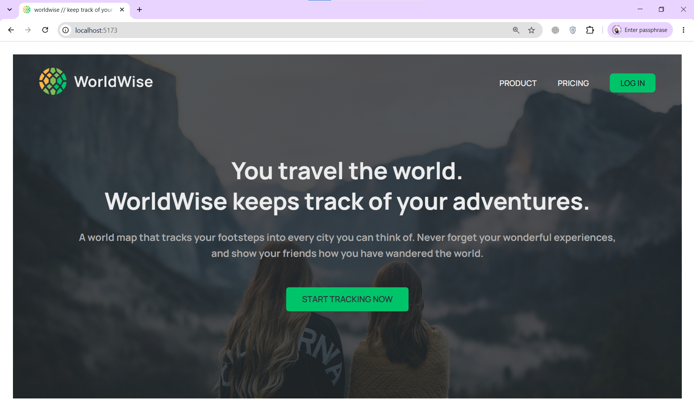
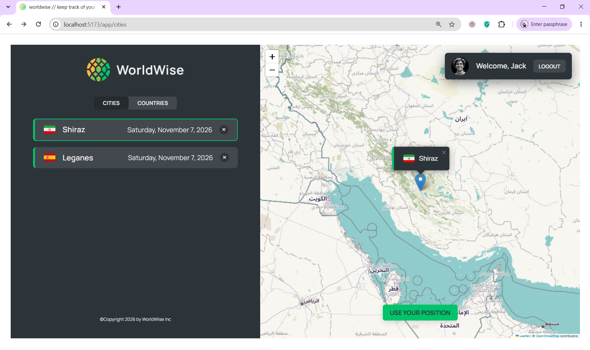
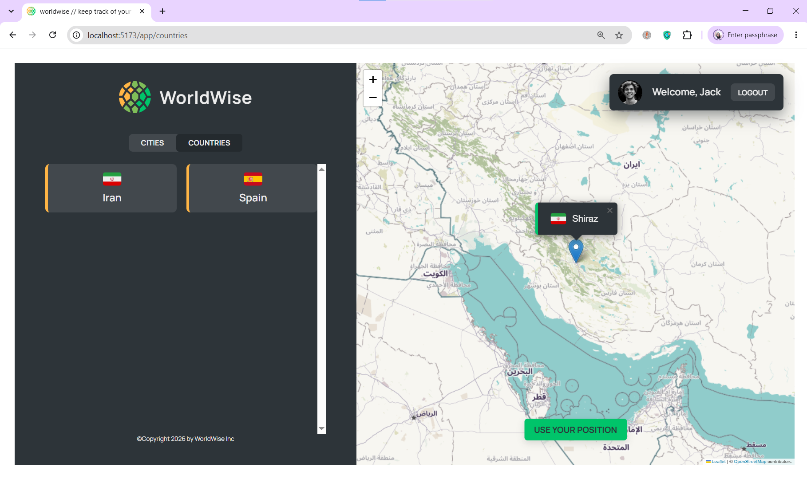
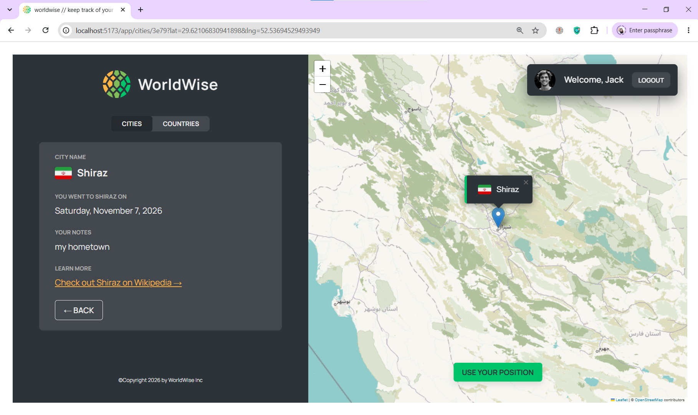
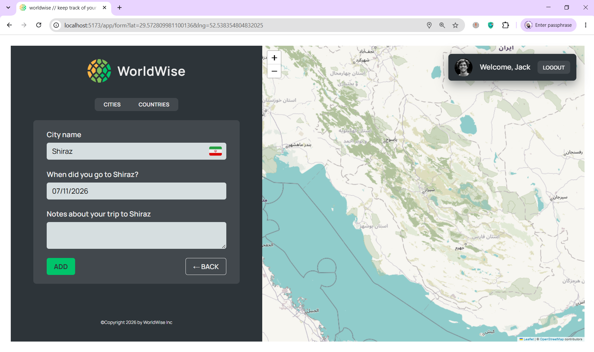

# WorldWise – Travel Tracking App

WorldWise is a travel tracking application built with React. It allows users to keep track of the cities and countries they have visited, explore their locations on an interactive map, and save their travel experiences.

## Features

- Interactive map powered by React Leaflet and Leaflet.
- Add and remove visited cities.
- Select locations directly on the map.
- View city details and travel dates.
- Browse saved cities and countries.
- Client-side routing with React Router.
- Protected routes with a demo authentication flow.
- State management using Context API and useReducer.
- Data persistence using JSON Server in development and localStorage in production.
- Persistent demo authentication across page refreshes.
- Support for direct navigation and page refreshes on deployed routes.

## Tech Stack

- React
- Vite
- React Router DOM
- Context API and useReducer
- React Leaflet and Leaflet
- JSON Server
- CSS
- Browser localStorage API

## Getting Started

### Prerequisites

- Node.js
- npm

### Installation

Clone the repository:

    git clone https://github.com/maryam-kaviyani/worldwise.git

Navigate to the project directory:

    cd worldwise

Install dependencies:

    npm install

### Run the Application

Start the JSON Server in a separate terminal:

    npm run server

Start the Vite development server in another terminal:

    npm run dev

Open the local URL displayed in your terminal.

**Note:** Both the JSON Server and Vite development server must be running for the development version to work correctly.

## Data Storage

WorldWise uses different data storage methods depending on the environment.

### Development

- City data is fetched from and saved to the local JSON Server API.
- JSON Server uses `data/cities.json` as its database.
- The city list starts empty.
- Both the JSON Server and Vite development server must be running.

### Production

In production deployments (Vercel and GitHub Pages):

- City data is stored in the browser's localStorage.
- The application starts with an empty city list on the first visit.
- Added and deleted cities remain saved after refreshing the page.
- Each browser and deployment domain has its own localStorage data.

**Important:** Data is stored locally in the browser, not in a shared database. Therefore, cities saved on Vercel are not automatically available on GitHub Pages or on another browser or device. Clearing the browser's site data may also remove saved cities.

## Authentication

This project uses a demo authentication flow for learning purposes.

- Authentication state is stored in localStorage.
- The user remains authenticated after refreshing the page.
- Logging out removes the stored authentication data.
- This implementation is for demonstration purposes only and is not suitable for production authentication or secure user management.

## Deployment

The application is configured for deployment on both platforms:

- **GitHub Pages:** https://maryam-kaviyani.github.io/worldwise/
- **Vercel:** https://worldwise-alpha-green.vercel.app/

The project uses environment-based configuration to support the different base paths required by each platform.

- Vite's base path is configured for GitHub Pages and Vercel.
- React Router uses the configured base URL to handle application routes.
- GitHub Pages uses a `404.html` fallback to provide a fallback for application routes and support page refreshes on nested routes.
- Vercel uses rewrite rules to serve the React application for frontend routes.

## Network Requirements

The application uses external map tile services to display the interactive map.

Depending on your network or geographic location, a VPN connection may be required to load the map correctly.

**Important:**

- The JSON Server API runs locally and does not require a VPN.
- A stable internet connection is required to load external map tiles.
- If the map does not load, check your internet connection and VPN availability.

## Build and Preview

To create a production build:

    npm run build

To preview the production build locally:

    npm run preview

Open the preview URL displayed in your terminal to test the production version.

## Project Purpose

This project was developed as part of my React learning journey, with a focus on component-based development, state management, client-side routing, API integration, interactive maps, authentication flow, and data persistence.

## Screenshots

### Home Page

### Cities List

### Countries List

### City Details

### Add City

